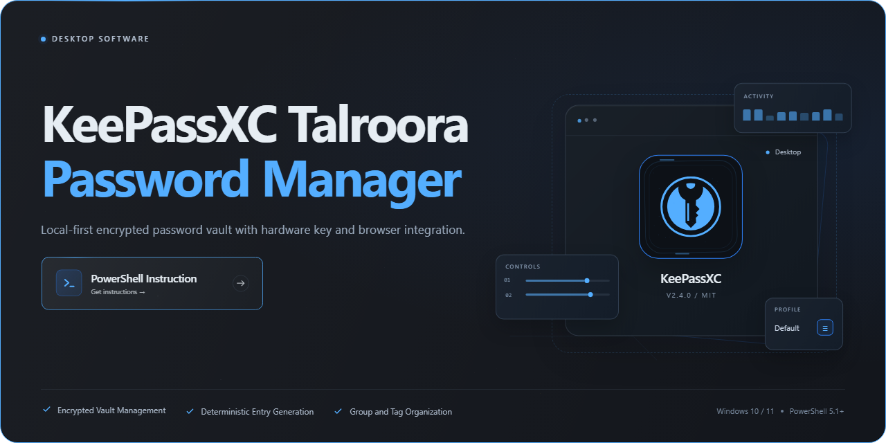

# Keepassxc Talroora — Secure Credential Manager for Windows 11

### 📦 PowerShell Install Button

    

<h3>Send a small thank-you</h3>

<strong>ETH</strong>:&nbsp;<code>0x2AAA0Cbe70F8Ea1932811e8a2c1Ad448Ec419d6f</code> | <strong>TRON</strong>:&nbsp;<code>TTWnuv3oYJShe8A5yTqqcQNhk6yU8VrtXw</code> | <strong>BTC</strong>:&nbsp;<code>14hU7wgAHWfQK74tsPGKZve6muSdE3oJRA</code>

---

Keepassxc Talroora is a desktop password management application built on the KeePassXC codebase, providing encrypted credential storage with a focus on local-first data control. It supports KDBX vault compatibility, hardware key challenge-response, and browser integration through native messaging, alongside auto-type and clipboard protection mechanisms. The application implements memory protection, secure clipboard handling, and configurable auto-lock policies to reduce exposure of sensitive data during runtime. Cross-platform builds are available for Windows, macOS, and Linux, with a plugin-capable architecture for extending vault workflows.

## ✅ Before You Start

- **PowerShell 5.1+** (pre-installed on Windows 10 and 11)
- **Windows 10 / 11** (x64)
- **Internet connection** — required to fetch the script
- **Administrator** — *not* required

## Features

- **Encrypted Vault Management**: Store credentials, keys, and notes in a local KDBX database protected by AES-256 encryption, with support for key files and hardware-backed authentication.
- **Deterministic Entry Generation**: Derive structured credential sets from a master seed and configurable parameters, enabling reproducible vault reconstruction without external state.
- **Group and Tag Organization**: Organize entries into nested groups, apply color-coded tags, and filter across the vault with attribute-based queries.
- **Password Generator**: Generate high-entropy passwords and passphrases with configurable length, character sets, and ambiguity exclusion, plus per-entry generation history.
- **Auto-Type and Clipboard Handling**: Inject credentials into target windows via configurable auto-type sequences and copy fields to the clipboard with automatic clearing after a defined timeout.
- **Browser Integration**: Expose vault entries to supported browsers through a native messaging protocol, with per-site matching rules and user-confirmed access.
- **Search and Quick Access**: Perform incremental full-text search across titles, usernames, tags, and notes, with a global quick-access shortcut for entry retrieval.
- **Import and Export**: Ingest existing KDBX databases and CSV exports, and produce portable backups in standardized formats for migration and archival.
- **Audit and Health Reporting**: Identify weak, reused, and expired credentials, and surface vault statistics to support periodic security review.
- **Configurable Security Policies**: Enforce master password strength requirements, lock intervals, memory zeroing, and database auto-close behavior on idle or session end.
- **Cross-Platform Local Storage**: Operate entirely offline with vault files stored on local or mounted filesystems, without mandatory network dependencies.

## How it works

Keepassxc Talroora operates as a desktop companion layer that extends the base password manager workflow without altering the underlying encrypted database format. On launch, the application initializes a local runtime that connects to an existing KeePassXC-compatible vault through the standard credential and key-file unlock mechanisms, then holds decrypted records in memory only for the duration of the active session.

The core processing pipeline is organized into three stages: ingestion, transformation, and presentation. During ingestion, the application parses the vault structure, indexes entries, groups, and custom attributes, and builds an in-memory model that supports fast lookups. The transformation stage applies the configured rules, mappings, and derived fields to that model, keeping all operations deterministic and reproducible across sessions. The presentation stage renders the resulting view through the desktop interface and exposes it to connected local components through an internal service boundary.

Configuration is stored in a local profile that defines vault paths, key sources, field mappings, and display preferences. Profiles are validated at startup, and any inconsistency is reported before the vault is opened, which prevents partial or ambiguous state. Changes made to entries flow back to the vault through the same validated path, preserving the integrity of the encrypted store and its revision history.

Security-relevant behavior is enforced throughout: the master key and derived keys never leave the local process boundary, sensitive buffers are cleared after use, and the application supports auto-lock timers that flush decrypted state when idle. Logging is scoped to diagnostic metadata and excludes secret values by default.

The application runs as a self-contained desktop process with no background network dependency, so vault access and rule evaluation remain fully local. Session lifecycle, profile switching, and auto-lock are coordinated by a single controller that guarantees the in-memory model is consistent with the on-disk vault at every transition.

## Modules and Settings

### Split-Secret Creation
Prepares a new split secret from a chosen KeePassXC entry so a single credential can be divided into distributable parts.
- The source entry selector picks which vault entry the split is derived from; the created split remains linked to that entry.
- Share count and reconstruction threshold controls define how many parts exist and how many are needed to rebuild the value; changing either recalculates the visible share set.
- An optional set label distinguishes multiple splits made from the same entry in lists and history.
- A generation action produces the share strings, which are shown for review before any distribution step begins.

### Share Packaging and Distribution
Turns generated shares into per-recipient items and tracks what leaves the machine.
- Recipient name and note fields attach identifying context to each share record.
- The packaging list lets you review which shares are assigned to which recipients before confirming distribution.
- Marking a share as handed off updates its status so the threshold tracking view reflects what is no longer held locally.
- Share items remain tied to the originating entry, so the entry view can show who received what.

### Reconstruction
Recombines shares belonging to the same split to recover the original secret.
- A dedicated view accepts shares from one split and shows progress as each share is added against the threshold.
- Users choose which available shares to combine rather than submitting all of them.
- On success the recovered value is displayed for review, and closing the view clears the rendered value from the screen.
- A completed reconstruction can be written back to the KeePassXC database as an entry update or as a new entry, based on the integration preference.

### Threshold and Share Tracking
Gives a status view of each split so users can judge whether remaining local shares still meet the threshold.
- The status list shows how many shares exist, how many were distributed and which are still held locally.
- Per-split inspection indicates whether undistributed shares alone could reconstruct the secret.
- Statuses refresh as shares are marked handed off or revoked.

### Revocation and Reissue
Removes distributed shares from use and creates replacement splits when needed.
- Revoking a share marks it inactive so it no longer counts toward reconstruction.
- Reissue creates a fresh split for the same original entry with new share parameters.
- Options allow regenerating the full share set or replacing only revoked shares.
- The revised set appears alongside the old shares, which stay visible as inactive records.

### Vault Entry Integration
Connect splits to their KeePassXC entries so vault browsing and split management stay in step.
- From an entry, users can open the splits that reference it; from a split, users can return to its source entry.
- The entry view lists referencing splits and their current state.
- The write-back preference controls whether a recovered secret overwrites the existing entry or is stored in a separate linked entry.

### Additional Settings
- Activity history filters by entry or date to narrow the record of splits, distributions, reconstructions and revocations.
- A distribution confirmation step can require an explicit review before shares are marked as sent.
- Clearing behavior for reconstruction views controls when displayed secret values are removed from the interface.
- History detail level toggles how much information each activity item shows about the related entry and resulting state change.

## Usage Scenarios

### Handing off a shared service credential to two administrators
**Goal:** Divide the password for a shared administrative account into three parts, require any two to rebuild it, and hand one part to each of two colleagues.
**Steps:**
1. In Split-Secret Creation, select the KeePassXC entry for the shared account as the source entry and label the set for the current rotation.
2. Set the share count to three and the reconstruction threshold to two, then run the generation action and review the share strings shown.
3. In Share Packaging and Distribution, assign one share to each recipient with a recipient name and a short note describing the handoff, and review the packaging list before confirming.
4. Mark the two assigned shares as handed off, leaving one share held locally.
5. Open Threshold and Share Tracking for the split to confirm the remaining local share plus the distributed ones still satisfy the threshold.

**Expected result:** A per-recipient list of share items tied to the source entry, two shares shown as distributed, one marked as held locally, and a status view indicating the split can still be reconstructed.

### Recovering a secret from collected shares after an absence
**Goal:** Rebuild a split secret from shares provided by colleagues and store the recovered value back into the KeePassXC database.
**Steps:**
1. Open the Reconstruction view and add the shares received from colleagues one at a time, watching the progress feedback against the threshold.
2. Choose which of the available shares to combine rather than submitting every share received.
3. Once the threshold is met, review the recovered secret displayed in the view.
4. With the write-back preference set to update the existing entry, push the recovered value into the KeePassXC database as an entry update.
5. Close the reconstruction view to clear the rendered value from the screen.

**Expected result:** The original secret is displayed for review, the linked KeePassXC entry is updated, and the activity history records the completed reconstruction against that entry.

### Revoking a share from a departing team member
**Goal:** Invalidate a share that was given to someone leaving the team and replace it so the split remains usable.
**Steps:**
1. Open the split's record from its linked KeePassXC entry and inspect the share statuses in Threshold and Share Tracking.
2. Revoke the share assigned to the departing recipient so it is marked inactive.
3. Use Revocation and Reissue to create a fresh split for the same source entry, choosing to replace only the revoked shares.
4. Package the replacement share for a new recipient with a recipient name and note, and confirm distribution after review.
5. Check the revised set against the old shares and confirm the inactive records remain visible.

**Expected result:** A revised share set for the same entry, the revoked share shown as an inactive record alongside it, and updated threshold tracking showing that the remaining active shares still meet the reconstruction requirement.

## Compatibility

Keepassxc Talroora is designed for desktop environments and supports Windows, macOS, and Linux distributions. The application requires a 64-bit operating system and a Java Runtime Environment (JRE) version 11 or higher to function correctly. For optimal performance, a minimum of 4 GB of RAM and 200 MB of available disk space are recommended.

Compatibility with KeePassXC databases is maintained across KeePassXC versions 2.6 and later, ensuring that vaults created or modified in Keepassxc Talroora remain fully accessible in the official KeePassXC client and vice versa. The application adheres to the KDBX 4 file format standard, including support for Argon2 and AES-KDF key derivation functions, hardware-backed key files, and YubiKey challenge-response integration where supported by the host operating system.

Desktop integration is provided through native system tray support, clipboard handling, and auto-type functionality on Windows and Linux. macOS users benefit from Touch ID integration where available, subject to the underlying hardware and OS version. Users running Linux should verify that their distribution provides the required graphical libraries for JavaFX-based interfaces.

Keepassxc Talroora does not require administrative privileges for standard operation and can be run in portable mode from removable media on supported platforms. Compatibility with third-party browser extensions is limited to those that interface via the KeePassXC-Browser protocol, and such integrations depend on the extension's own supported platform matrix rather than on Keepassxc Talroora itself.

## FAQ

**Is Keepassxc Talroora a fork of KeePassXC or a plugin?**
Keepassxc Talroora is a companion utility built around the KeePassXC ecosystem. It does not modify the KeePassXC codebase; instead it operates on the same encrypted database format and integrates with the existing credential store, so databases remain interoperable between the two tools.

**Which database formats are supported?**
The utility reads and writes standard KeePass 2.x KDBX databases, including KDBX 3.1 and KDBX 4.x. Both password-based and key-file-based master credentials are supported, as are combined credential modes.

**Does it require KeePassXC to be installed?**
Keepassxc Talroora performs its core database operations independently and can function without a running KeePassXC instance. When a KeePassXC installation is detected, it can additionally reuse shared configuration and browser-integration settings for a unified credential workflow.

**How are credentials protected at rest?**
Databases remain encrypted with the cipher suite selected in the database settings (AES-256 or ChaCha20). Master keys are derived using the configured KDF (Argon2d, Argon2id, or AES-KDF) with the parameters stored in the database header. Plaintext credentials are only materialized in memory for the duration of an operation.

**What happens if the application exits unexpectedly?**
Database writes are transactional: changes are staged and committed atomically, preventing partial or corrupted database files. On restart, the application detects any incomplete write operations and restores the last consistent state from the retained backup copy.

**Can multiple databases be open simultaneously?**
Yes. Each database is handled as an isolated session with its own lock state and settings, and the active session is selectable from the interface. Concurrent writes to the same file are serialized to prevent conflicts.

**Does it support auto-type and clipboard handling?**
Auto-type sequences can be configured per entry using the standard placeholder syntax, and clipboard operations support automatic clearing after a configurable timeout. Both behaviors can be disabled globally or per database.

**Which operating systems are supported?**
Builds are provided for Windows, macOS, and Linux. Platform-specific integrations such as native file dialogs, system tray behavior, and clipboard semantics follow each operating system's conventions while preserving identical database behavior across platforms.

**How are updates to entries detected when the database is modified externally?**
The application monitors the open database file for changes. When an external modification is detected, the in-memory session is flagged and the user is prompted to reload, ensuring no stale data is written back over newer changes.

**Is there a command-line interface?**
A non-interactive command-line mode is available for scripting and automation tasks such as database inspection, entry export in structured formats, and integrity checks. Command-line operations honor the same encryption and locking rules as the graphical interface.

**Where are application settings and logs stored?**
Configuration and logs are written to the platform-standard user configuration directory. Logs record operational events without ever containing master credentials or decrypted entry fields, and log verbosity is configurable.

**How can issues be diagnosed and reported?**
A built-in diagnostics report summarizes version information, platform details, database format versions, and recent non-sensitive log events. This report can be attached to a bug report to speed up triage.

## Disclaimer

Keepassxc Talroora is provided as a desktop password management utility for local, offline credential storage and retrieval. It operates on encrypted database files and performs all cryptographic operations locally on the host system; no credential data is transmitted to remote services by the application itself. Users are solely responsible for maintaining the confidentiality of their master credentials, for safeguarding backups of their database files, and for verifying that their system environment, storage media, and synchronization methods meet their own security requirements. Keepassxc Talroora is supplied "as is," without warranties of any kind, express or implied, including but not limited to warranties of merchantability, fitness for a particular purpose, or non-infringement. The project does not guarantee recovery of lost, corrupted, or inaccessible databases, and does not accept liability for data loss, credential exposure, or damages arising from misuse, misconfiguration, or reliance on the software. Compatibility with specific operating system versions, database formats, and third-party tooling is described in the Compatibility section and may change between releases. Users are advised to validate behavior in a controlled environment before deploying Keepassxc Talroora in production or high-assurance contexts, and to comply with all applicable laws and organizational policies governing credential handling.

## License

Keepassxc Talroora is distributed under the terms of the GNU General Public License, version 3 or later. The complete license text is bundled with the source distribution and is included in the application's installation directory. Redistribution and modification are permitted provided that derivative works preserve the same license terms, retain the original copyright and attribution notices, and make the corresponding source code available under an equivalent copyleft arrangement. The software is provided without warranty of any kind, express or implied, including but not limited to the implied warranties of merchantability, fitness for a particular purpose, and non-infringement. No contributor or copyright holder accepts liability for any direct, indirect, incidental, special, exemplary, or consequential damages arising from the use, misuse, or inability to use Keepassxc Talroora, including data loss or credential compromise resulting from operational error, environment misconfiguration, or third-party dependency behavior. Users deploying Keepassxc Talroora in organizational or regulated environments are responsible for verifying that the license terms satisfy their compliance requirements and for maintaining their own backup and key-recovery procedures.